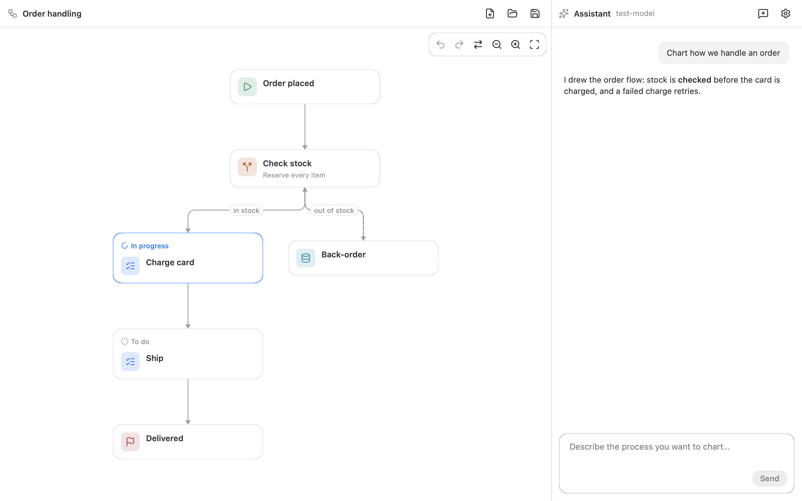

<p align="center">
  
</p>

<h1 align="center">Scenra</h1>

<p align="center">
  <strong>简体中文</strong> |
  <a href="README.md">English</a>
</p>

<p align="center">
  <a href="https://github.com/oneo-me"></a>
  <a href="https://oneo.me"></a>
  <a href="https://x.com/oneo666"></a>
  <a href="https://github.com/sponsors/oneo-me"></a>
</p>

<p align="center">
  一款桌面应用与流程设计工具：和 AI 助手对话来设计应用的界面和流程图，助手按商定的内容把它们画出来。
</p>

<p align="center">
  
</p>

## 名称由来

Scenra 是一个自造词：*scene*（场景）指构成应用的一个个界面，*-ra* 指从一个界面走向下一个界面的流程。一个 Scenra 文件里装的正是这两样：界面，以及它们之间的路径。

## 功能

- Scenra 文件以标签页的形式排在窗口顶部；左侧列出每个界面的设计和流程图，中间是打开的那个，右侧是贯穿窗口高度的对话。
- 文件会记住打开或保存时的路径，按 ⌘S 直接原地保存，下次启动时重新打开。
- 手机、平板和桌面设计由方块、文本、图标、图片和 SVG 组成，用 Tailwind CSS 类名塑造外观，草图可以画成任何样子；和流程图一样可以缩放、平移并选择其中的元素。
- 助手是你已安装的编程 agent，如 Claude Code、Codex、pi 或 CodeBuddy Code：它先问清需要的信息，再按 Scenra 技能的说明编写文件，文件边写边重新绘制。
- 助手基于你选中的内容工作，处理你在设计元素上留下的评论，并在文件所在的文件夹中工作，因此能画出那里的代码如何运作。
- 发送消息会保存你的修改；助手工作期间文件保持它写下的样子，它的每一轮修改可作为一步撤销。
- 设计保存为纯文本 `.scenra` 文件，可直接阅读、对比和手动编辑。
- 运行于 macOS、Windows 和 Linux，支持英文和简体中文。

## 运行

Scenra 需要 [Go](https://go.dev/dl/)。在仓库根目录执行：

```sh
go tool nsgo dev cmd/scenra     # run
go tool nsgo build cmd/scenra   # build macOS, Windows and Linux into cmd/scenra/dist/
```

在 macOS 上，可以从访达用本应用打开 `.scenra` 文件；在 Windows 和 Linux 上，命令行中给出的 Scenra 文件会在启动时打开。

## 快速开始

1. 安装并登录一个编程 agent，如 [Claude Code](https://claude.com/claude-code) 或 [Codex](https://github.com/openai/codex)；**设置**（⌘,）列出 Scenra 找到的 agent，可开关它们及其模型。
2. 在助手中描述一个应用或流程，例如“设计一个咖啡店应用的登录界面”或“画出我们处理订单的流程”。
3. 要为现有项目画流程图，把 Scenra 文件保存在项目文件夹中：助手会在那里工作。
4. 回答它的问题，看它画出界面和流程；在左侧选择某个界面的设计或流程。
5. 新建文件时先选择保存位置，之后按 ⌘S 保存；也可以打开 `examples/shop.scenra` 或 `examples/order.scenra` 从示例开始。

文件格式见 [`flowfile` 包注释](flowfile/)。

## 使用统计

正式构建会向 Umami 发送匿名使用统计：应用的使用次数和时长，附带一个随机的安装 ID。不会发送流程图、消息或文件路径。可在**设置** → **统计**中关闭。`nsgo dev` 的构建和测试不发送任何统计。

## 在你的应用中使用

`scenraview` 为其他 NSGo 应用提供 Scenra 的 `.scenra` 文件编辑器：一个管理已打开文件的 `Editor` 及其视图，可以直接使用 Scenra 的 `Window`，也可以用 `TabBar`、`Sidebar`、`Workspace` 和 `Assistant` 自行布局。助手运行 [Agio](https://github.com/oneo-me/nsgo-agio) 后端的 agent；请把 `cmd/scenra/resources/skills/scenra` 中的技能和告诉它们用户所见内容的 `Server` 交给它们。

```sh
go get github.com/oneo-me/nsgo-scenra
```

```go
nsgo.Run(func(cx *core.Scope) core.Node {
	e := scenraview.New(cx, scenraview.Options{})
	e.OpenPath("app.scenra")
	return core.View{Style: core.Style{Direction: core.Row, FlexGrow: 1}, Children: []core.Node{
		scenraview.Sidebar{Editor: e}, scenraview.Workspace{Editor: e},
	}}
})
```

`flowfile` 不依赖 NSGo 即可读写该格式。

## 开发

在仓库根目录执行：

```sh
go tool nsgo check          # vet, catalogs and generated files
go tool nsgo test           # tests, headless against a scripted agent
```

设计见 [ARCHITECTURE.md](ARCHITECTURE.md)，贡献规则见 [AGENTS.md](AGENTS.md)。

变更记录见 [CHANGELOG.md](CHANGELOG.md)。

## 许可证

Scenra 以 [MIT 许可证](LICENSE) 发布。贡献内容按同一许可证接受。
