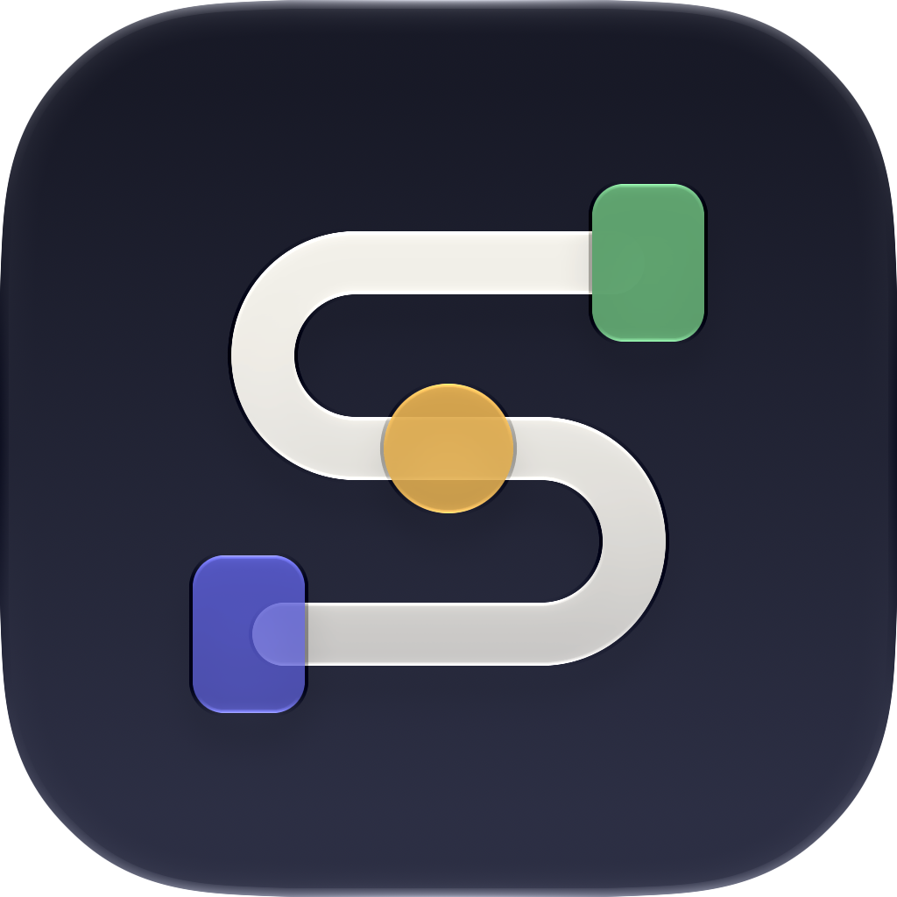

<p align="center">
  
</p>

<h1 align="center">Scenra</h1>

<p align="center">
  <strong>简体中文</strong> |
  <a href="README.md">English</a>
</p>

<p align="center">
  <a href="https://github.com/oneo-me"></a>
  <a href="https://oneo.me"></a>
  <a href="https://x.com/oneo666"></a>
  <a href="https://github.com/sponsors/oneo-me"></a>
</p>

<p align="center">
  一款桌面应用与流程设计工具：和 AI 助手对话来设计应用的界面和流程图，助手按商定的内容把它们画出来。
</p>

<p align="center">
  
</p>

## 名称由来

Scenra 是一个自造词：*scene*（场景）指构成应用的一个个界面，*-ra* 指从一个界面走向下一个界面的流程。一个 Scenra 项目装的正是这两样：一个文件夹，里面有各个界面的设计，以及它们之间路径的流程图。

## 功能

- Scenra 以文件夹为工作区：左侧列出其中的 Scenra 文件，每个文件装着若干设计图或若干流程图，窗口和界面放在文件夹顶层，并按 `订单/详情` 这样的名称分组，排在顶部的组件、「流程」和「子视图」分组下方，前者收纳 `flows/` 里的流程图，后者收纳 `views/` 里填进这些窗口的页面，选中的文件显示在旁边，右侧是贯穿窗口高度的对话；⌘B 隐藏两侧，把整个窗口留给画布。⌘1 以实际大小显示画布，⌘2 使其适合窗口，⌘+ 和 ⌘- 放大和缩小。文件夹在 Git 仓库中时，每个文件旁显示它自上次提交以来增删的行数。
- 界面上发生的事由它自己的设计展示，靠点击、outlet 和备注；`flows/` 里的流程图是独立的工作流，如结账，按它做的事命名，而不是对应某个界面。
- 每个文件夹在自己的标签页中打开，各有各的对话；最前面的首页列出最近打开的文件夹，各以其中一个设计为封面，并提供设置。切换到其他文件会保存当前文件，⌘S 也会保存，关闭标签页（⌘W）会保存其中的文件；标签页及其文件会在下次启动时重新打开。
- 手机、平板和桌面设计由方块、文本、图标、图片和 SVG 组成，用 Tailwind CSS 类名塑造外观，草图可以画成任何样子；和流程图一样可以缩放、平移并选择其中的元素。
- 助手是你已安装的编程 agent，如 Claude Code、Codex、pi 或 CodeBuddy Code：它先问清需要的信息，再按 Scenra 技能的说明编写和新建文件夹中的文件，每个文件边写边重新绘制。
- 设计可以像应用一样点着用：点击元素会打开另一个界面、关闭当前界面或切换标签页，标签栏会标出当前所在的界面。界面可以填进窗口的内容区，点着用窗口时只替换内容区，侧边栏一直都在。
- 指针在元素上停留一会就会显示它的评论和备注：评论请助手修改，备注记下设计图表达不了的内容。
- 助手基于你选中的内容工作，处理你的评论、让备注与设计保持一致，并在打开的文件夹中工作，因此能画出那里的代码如何运作。
- 发送消息会保存你的修改；助手工作期间文件保持它写下的样子，它的每一轮修改可作为一步撤销。
- 多个界面共用的部分（如标签栏）是文件夹中 `components/` 下的组件，设计用 `use` 绘制它们，改一处即改所有界面；像 Figma 的实例一样，引用处可以选用组件的变体，替换组件中命名元素的文字、图标、样式和点按，并用自己的元素（包括其他组件）填充组件留出的插槽。它们不在列表中列出，而由列表上方的**组件**集中在一个画布上展示，像文件一样按名称分组，较小的组件会放大以便看清。
- 设计中的图片放在文件夹的 `assets/` 下，助手会把你给它的图片复制到这里，图片元素用 `src="assets/…"` 引用它们。
- 设计保存为纯文本 `.scenra` 文件，可直接阅读、对比和手动编辑。
- 运行于 macOS、Windows 和 Linux，支持英文和简体中文。

## 运行

Scenra 需要 [Go](https://go.dev/dl/)。在仓库根目录执行：

```sh
go tool nsgo dev cmd/scenra     # run
go tool nsgo build cmd/scenra   # build macOS, Windows and Linux into cmd/scenra/dist/
```

在 macOS 上，可以从访达用本应用打开 `.scenra` 文件；在 Windows 和 Linux 上，命令行中给出的 Scenra 文件或文件夹会在启动时打开。打开文件时会一并打开它所在的文件夹。

## 快速开始

1. 安装并登录一个编程 agent，如 [Claude Code](https://claude.com/claude-code) 或 [Codex](https://github.com/openai/codex)；首页的**设置**（⌘,）列出 Scenra 找到的 agent，可开关它们及其模型；在**对话命名**中可填写一个 OpenAI 兼容接口的模型，它会根据第一条消息为新对话命名。
2. 打开一个文件夹（⌘O），比如某个项目的文件夹，助手会在那里工作；也可以打开 `examples/coffee-shop` 从示例开始；它在新标签页中打开，之后也可从首页的**最近**再次打开。
3. 在助手中描述一个应用或流程，例如“设计一个咖啡店应用的登录界面”或“画出我们处理订单的流程”。
4. 回答它的问题，看它新建并画出设计和流程；在左侧的列表中选择要看的文件。
5. 按 ⌘N 开始新对话；新对话沿用上次选择的 agent、模型及其设置。

文件格式见 [`flowfile` 包注释](flowfile/)。

## 使用统计

正式构建会向 Umami 发送匿名使用统计：应用的使用次数和时长，附带一个随机的安装 ID。不会发送流程图、消息或文件路径。可在**设置** → **统计**中关闭。`nsgo dev` 的构建和测试不发送任何统计。

## 在你的应用中使用

`scenraview` 为其他 NSGo 应用提供 Scenra 的 `.scenra` 文件编辑器：一个管理文件夹及当前文件的 `Editor` 及其视图，可以直接使用 Scenra 的 `Window`，也可以用 `Header`、`Sidebar`、`Workspace` 和 `Assistant` 自行布局。助手运行 [Agio](https://github.com/oneo-me/nsgo-agio) 后端的 agent；请把 `cmd/scenra/resources/skills/scenra` 中的技能和告诉它们用户所见内容的 `Server` 交给它们；`Server` 按每个对话的指令所给的 ID 区分多个编辑器。`Cover` 把一个项目画成缩略图，如 Scenra 的最近文件夹所示。

```sh
go get github.com/oneo-me/nsgo-scenra
```

```go
nsgo.Run(func(cx *core.Scope) core.Node {
	e := scenraview.New(cx, scenraview.Options{})
	e.OpenPath("designs") // a folder, or a file, which opens with its folder
	return core.View{Style: core.Style{Direction: core.Row, FlexGrow: 1}, Children: []core.Node{
		scenraview.Sidebar{Editor: e}, scenraview.Workspace{Editor: e},
	}}
})
```

`flowfile` 不依赖 NSGo 即可读写该格式。

## 开发

在仓库根目录执行：

```sh
go tool nsgo check          # vet, catalogs and generated files
go tool nsgo test           # tests, headless against a scripted agent
```

设计见 [ARCHITECTURE.md](ARCHITECTURE.md)，贡献规则见 [AGENTS.md](AGENTS.md)。

变更记录见 [CHANGELOG.md](CHANGELOG.md)。

## 许可证

Scenra 以 [MIT 许可证](LICENSE) 发布。贡献内容按同一许可证接受。
